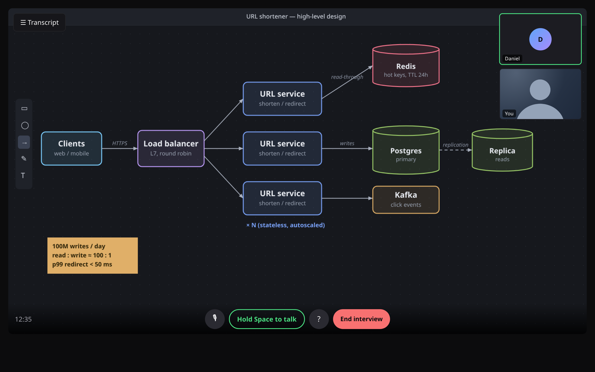
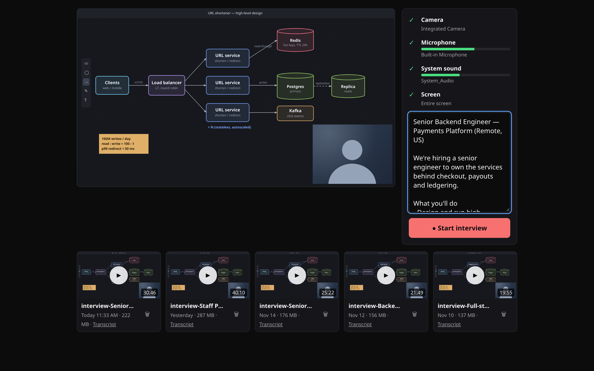
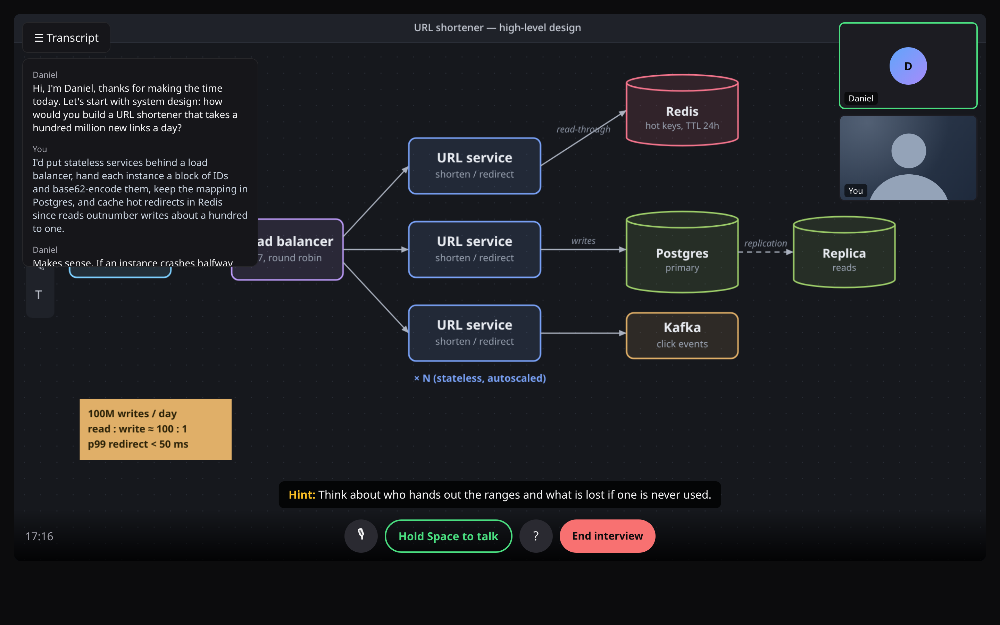

# Mock Interview

Practice job interviews out loud. Paste a job post and an AI interviewer runs a video-call style interview with you, then saves the recording so you can watch yourself back.

## What it does

- Reads the job post and prepares questions that fit the role and level.
- Daniel, the interviewer, asks them out loud and follows up on your answers.
- Just talk. Daniel waits until you finish, and you can cut in while he speaks. Ask for a hint any time.
- Records your screen, camera and both voices, with a written transcript.
- Keeps a library of past interviews to replay.
- Runs on your own computer. No scores, no grades, just practice.

| Before the interview | During: transcript and hints |
| --- | --- |
|  |  |

## Quick start

1. `npm install`, then copy `.env.example` to `.env` and add your DeepSeek API key.
2. Start the voice services: speech-to-text (`stt/run.sh`) and Daniel's voice (`tts/run.sh`).
3. `npm run dev` and open the page in Chrome.
4. Wait for the checks to turn green, share your screen, paste a job post, and click **Start interview**.

Full setup: [docs/setup.md](docs/setup.md). How it works: [docs/architecture.md](docs/architecture.md).
