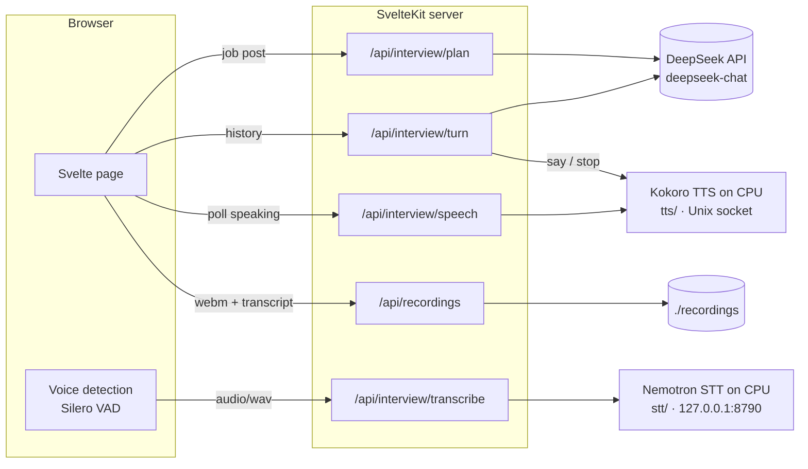
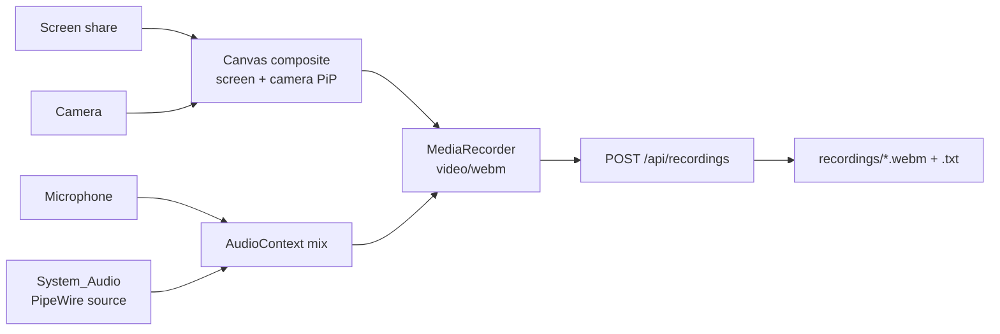

# Architecture



Each turn: the browser posts the conversation so far to `/api/interview/turn`, the server asks DeepSeek for Daniel's next line, tells Kokoro to speak it, and returns the text. The browser polls `/api/interview/speech` to light up Daniel's tile while he talks.

Turns are hands-free. A voice activity detector (Silero, via `@ricky0123/vad-web`) listens to the mic; after 1.5 s of silence the utterance is sent as WAV to `/api/interview/transcribe`, then `/api/interview/turn`. Speech shorter than 300 ms is ignored. Speaking while Daniel talks stops him (`DELETE /api/interview/speech`). Speech while a reply is in flight is dropped. Its model, worklet and ONNX runtime files are copied from `node_modules` to `static/vad/` by `npm run vad-assets`, which `npm install` runs.

The recording is built entirely in the browser:



The canvas is redrawn from a Web Worker timer so recording keeps going when the tab is in the background.

## Tech stack

- SvelteKit 3, Svelte 5 (runes), TypeScript, Vite
- DeepSeek chat completions (OpenAI-compatible API)
- Kokoro TTS (`Kokoro-82M`, voice `bm_daniel`) on CPU, served by a small Python Unix-socket server
- NVIDIA Nemotron speech-to-text (`nemotron-speech-streaming-en-0.6b`, int8 ONNX) on CPU, served by a small Rust HTTP server using `parakeet-rs`
- Browser media APIs: `getDisplayMedia`, `getUserMedia`, Canvas `captureStream`, Web Audio, `MediaRecorder`
- PipeWire loopback for system audio capture
- Silero VAD in the browser via `@ricky0123/vad-web` (ONNX Runtime Web)
- Vitest and Playwright

## Kokoro socket protocol

`src/lib/server/kokoro.ts` opens one connection per request to `$XDG_RUNTIME_DIR/interview-kokoro.sock` (served by `tts/server.py`), writes one JSON line, reads one JSON line back, and closes. Requests time out after 5 seconds.

| Request | Meaning | Reply |
| --- | --- | --- |
| `{"cmd":"say","text":"..."}` | Queue text to speak | `{"ok":true}` |
| `{"cmd":"stop"}` | Stop speaking and drop the queue | `{"ok":true}` |
| `{"cmd":"status"}` | Is anything playing? | `{"ok":true,"speaking":false,"queued":0}` |

Any failure replies `{"ok":false,"error":"..."}`. Any TTS engine works as long as it answers these three commands and plays to the default audio output (so `System_Audio` records it).

## Project structure

```
src/
  routes/
    +page.svelte              setup screen, library, call phases
    +page.server.ts           library listing and delete action
    api/interview/            plan, turn, speech, transcribe endpoints
    api/recordings/           upload recording and transcript
    recordings/[name]/        stream a recording (range requests) and its transcript
  lib/
    Call.svelte               in-call view: tiles, dock, turn-taking, hints, save
    vad.ts                    voice activity detection on the mic (Silero via @ricky0123/vad-web)
    devices.svelte.ts         device checks and level meters
    media.ts                  canvas composite, audio mix, MediaRecorder, upload
    transcript.ts             transcript formatting
    server/                   DeepSeek, Kokoro, STT clients, interview prompts, file storage
stt/                          Nemotron speech-to-text server (Rust); model in stt/models/
tts/                          Kokoro speech server (CPU); model cached in tts/models/
e2e/                          Playwright tests with fake media
docs/                         design notes, plan, screenshots
```
